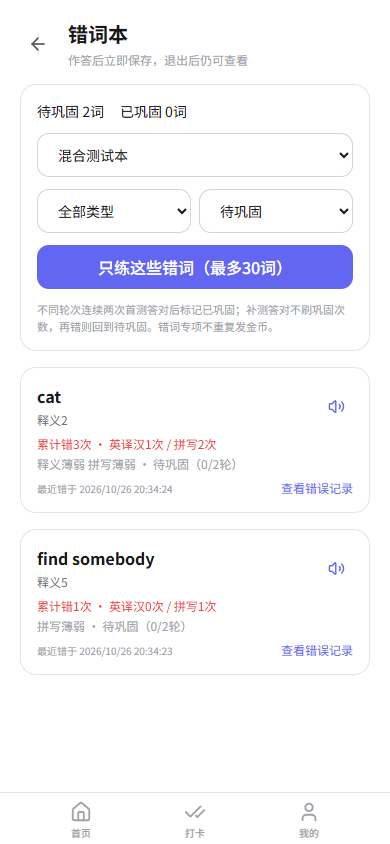

# 学习助手 · Study Assistant

以英语词汇学习为核心的个人学习工具，支持浏览器与 Android。使用 **React + TypeScript + FastAPI + IndexedDB + Capacitor**，覆盖词汇整理、客观检测、错词巩固和间隔复习。

> 这是用于代码展示和本地运行的脱敏源码快照。**不包含实际模型配置、API Key、线上服务器地址、用户数据或安装包。** 不依赖作者的在线服务，AI 功能需使用者自行配置。

## 核心功能

- **词汇入库**：手动输入、换行批量粘贴、最多三张照片识别、人工纠错、跨图与已有词条去重；词库优先查询，缺失释义可由模型补全。
- **单词本与学习计划**：自定义多个单词本，分别设置数量、每日目标及检测模式；支持暂停、删除、恢复和重新创建，不覆盖其他计划的进度。
- **客观检测**：限时英译汉、中文提示拼写、随机穿插的混合模式；保存轮次与题型，退出后继续。
- **错词与复习**：累计错误、原始答案与正确答案追溯、错词专项训练；固定两遍复测，仍错的词保留待巩固；接入 FSRS 间隔复习。
- **读音**：Android 原生本地文字转语音；正式检测提交后才开放读音，缺少英文语音包时给出设置提示。
- **数据管理**：本地优先存储、按账号隔离、云备份与恢复；通过事务保存作答与学习进度，防止重复提交。

辅助模块包含学习打卡、番茄钟、成绩记录、作文批改及图片答疑。其中 **AI 答疑与识图仍为实验性辅助功能，不能保证解题准确性**，不应替代教材、标准答案或教师判断。

## 界面示例

以下图片来自隔离的自动化测试数据，不包含真实用户信息。



## 工程实践

- IndexedDB / Dexie 复合索引与分页查询，词表仅挂载当前页；路由懒加载降低首屏负担。
- 检测、学习、复测、完成组成可恢复的学习流程；原始作答作为统计依据，不用反复补测覆盖首测成绩。
- 作答记录、FSRS 状态与轮次位置在同一事务中提交；轮次版本和作答标识拦截重复提交。
- 长耗时图片答疑通过任务提交、状态查询与结果保存处理，避免依赖移动端一直保持一个 HTTP 请求。
- 独立的浏览器端回归及 Python 离线测试覆盖计划生命周期、账号隔离、备份恢复、数据升级和识别异常。

详见 [架构与数据边界](docs/architecture.md)、[测试说明](docs/testing.md) 和 [安全说明](SECURITY.md)。

依赖扫描仍有已知告警，见 [依赖检查记录](docs/dependency-audit.md)。本次脱敏不等于安全审计或生产就绪认证。

## 本地启动

建议使用 Node.js 20+、Python 3.10+；Android 构建需要 JDK 17 和 Android SDK。开发代理默认把 `/api` 转发到本机 `8003` 端口。

### 1. 后端

在仓库根目录执行：

```bash
python -m venv .venv
# Windows PowerShell: .\.venv\Scripts\Activate.ps1
# macOS / Linux: source .venv/bin/activate
python -m pip install -r backend/requirements.txt
```

将 `backend/.env.example` 复制成 `backend/.env`。示例中模型及鉴权值全部留空，按需填写自己的配置。随后：

```bash
cd backend
python run.py
```

接口文档：<http://127.0.0.1:8003/docs>。首次运行创建本地用户数据库和 JWT 签名文件，两者均被 Git 忽略。

### 2. 前端

另开终端，在仓库根目录执行：

```bash
npm ci
npm run dev
```

访问终端显示的本地地址，注册自己的本地测试账号。未配置模型时，手动词汇录入、学习计划、检测及打卡等功能可用；AI 接口不能使用。

### 3. 可选：构建考试词库

为避免混入运行数据与大文件，本仓库不附带 CSV 或生成的数据库。请从 [ECDICT](https://github.com/skywind3000/ECDICT) 获取 `ecdict.csv`，放入 `backend/dictionary_source/`，再执行：

```bash
python backend/scripts/build_dictionary.py
```

构建后产生 `backend/data/dictionary.db`，考试词书列表才会有数据。保留上游许可证，详见 [第三方数据声明](backend/THIRD_PARTY_NOTICES.md)。

### 4. Android

将根目录 `.env.example` 复制成 `.env.production`，把 `VITE_API_BASE_URL` 填为自己可访问的 HTTPS 后端地址，不要填写模型密钥。然后：

```bash
npm run android:sync
cd android
# Windows: .\gradlew.bat assembleDebug
# macOS / Linux: sh ./gradlew assembleDebug
```

产物位于 `android/app/build/outputs/apk/debug/`。也可用 Android Studio 打开 `android/` 配置自己的 SDK 路径。仓库不包含作者的签名、SDK 本机路径或已编译资源。

## 已知限制

- 短语选择题的干扰项仍需进一步优化，当前不承诺语义难度和唯一性已经经过完整评测。
- AI 识图、解题和释义存在漏识别、推理错误及幻觉风险，保留人工核对入口。
- 云功能目前是手动备份/恢复，不是实时多端同步。
- 图片答疑任务采用单进程异步处理，不是分布式队列；服务重启时仅恢复 pending 任务，运行中的任务恢复仍需完善。
- 本地语音依赖设备已安装的英文语音包；电脑浏览器性能测试不代表手机音质或耗时。
- 升级前已有的旧轮次保留原规则；真正混合与有界复测从新轮次生效。

## 关于许可

项目代码目前未指定开源许可证；仓库可见性不等于授予开源许可。第三方依赖和 ECDICT 数据遵循各自许可证。后续公开前应单独确定项目许可证及发布策略。
